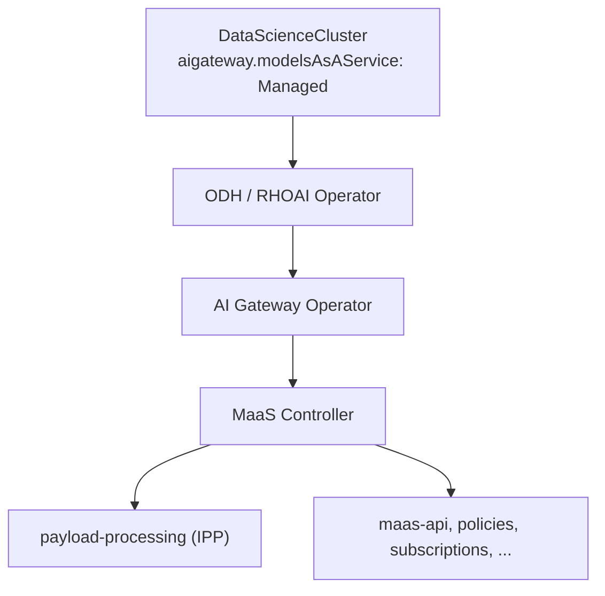
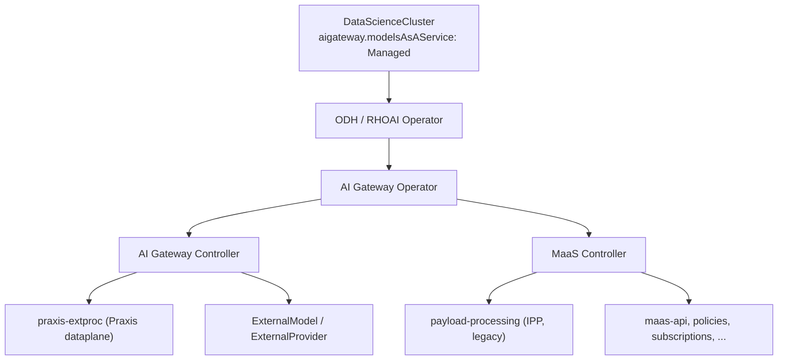

# AI Gateway control-plane architecture

Who deploys what, and which component owns which concern. This is a
deployment and ownership map — not an implementer ADR. For package layout,
handshake edge cases, and deferred work, see [DESIGN.md](../DESIGN.md).
For the inference request path (Envoy filters, IPP → Praxis), see
[Praxis dataplane evolution](./praxis-dataplane-evolution.md).

## At a glance

| Component | Role |
| --- | --- |
| **ODH / RHOAI operator** | Reconciles `DataScienceCluster`; enables AI Gateway via `aigateway.modelsAsAService` |
| **AI Gateway Operator** | Deploys sibling controllers when MaaS is `Managed` |
| **ai-gateway-controller** | External-model control plane; installs per-tenant **Praxis** ExtProc |
| **maas-controller** | MaaS platform (maas-api, policies, subscriptions, tenant bootstrap); legacy **IPP** ExtProc when selected |
| **praxis-extproc** | ExtProc dataplane only (payload filters) |
| **payload-processing (IPP)** | Legacy ExtProc dataplane (and, before the split, also external-model control plane) |

## Pre-3.6 (MaaS + IPP only)

`ai-gateway-controller` is not deployed. IPP owns both external-model
control plane and ExtProc dataplane.

| Concern | Owner |
| --- | --- |
| ExtProc dataplane | IPP via maas-controller tenant reconcile |
| ExternalModel / ExternalProvider reconcile | IPP |
| Auth, API keys, rate limits, subscriptions | maas-controller → maas-api / Kuadrant |
| Tenant namespaces, Gateway claim | maas-controller (`AITenant` / `MaasTenantConfig`) |

## 3.6 (sibling controllers + Praxis)

AI Gateway Operator deploys **both** `ai-gateway-controller` and
`maas-controller`. External-model control plane and Praxis ExtProc move to
this repository; IPP remains available per tenant during migration.

### Responsibility split

| Concern | ai-gateway-controller | maas-controller |
| --- | --- | --- |
| Install ExtProc when Praxis is selected | Yes (`praxis-extproc`) | No |
| Install ExtProc when IPP is selected | No | Yes (IPP) |
| Reconcile `ExternalModel` / `ExternalProvider` (routes, transport, overlay) | Yes | No (after the split) |
| Auth / API keys / rate limits / subscriptions | No | Yes |
| Own `AITenant` status and tenant bootstrap | No (reads only) | Yes |
| Select dataplane backend per tenant | Reads selector; claims Praxis | Reads same selector; claims IPP |

Dataplane selection and the Praxis ↔ IPP handoff are covered in
[Dataplane selection](./dataplane-selection.md).

## Lifecycle (shared with MaaS)

There is **no** separate enablement flag for `ai-gateway-controller`.

| `AIGateway` / MaaS `managementState` | Result |
| --- | --- |
| `Managed` | Operator deploys **both** siblings |
| `Removed` | Both tear down (same grace window as MaaS; ExtProc may still be serving) |

`ModelsAsAServiceReady` reflects readiness of both Deployments.

## Related docs

| Doc | Audience |
| --- | --- |
| [Dataplane selection](./dataplane-selection.md) | Choosing Praxis vs IPP; handoff states |
| [External models](./external-models.md) | When and how models are served |
| [Praxis dataplane evolution](./praxis-dataplane-evolution.md) | Request-path filter map |
| [DESIGN.md](../DESIGN.md) | Implementer detail |
