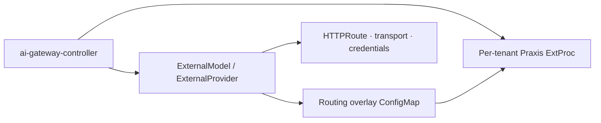

# What ai-gateway-controller deploys

`ai-gateway-controller` installs the **Praxis** ExtProc dataplane for each
ready tenant and reconciles **ExternalModel** / **ExternalProvider** into
Gateway routes and ExtProc routing config.

This page lists the objects this controller creates by default. Auth, API
keys, rate limits, and tenant bootstrap belong to MaaS — see
[External models](./external-models.md) for the serving path, and
[DESIGN.md](../DESIGN.md) for implementer detail (including legacy
migration).

## Two jobs

| Job | Trigger | Result |
| --- | --- | --- |
| **Dataplane install** | Tenant `MaasTenantConfig` is ready for Praxis | Per-tenant `praxis-extproc` workloads and Gateway filters |
| **External-model control plane** | `ExternalModel` / `ExternalProvider` | Routes, provider transport, credential projections, ExtProc overlay |

## Per-tenant Praxis dataplane

For each tenant whose Gateway is ready, the controller applies a renamed copy
of the vendored Praxis ExtProc manifests into the **Gateway namespace**
(default tenant keeps unsuffixed names; other tenants use `{base}-{tenantID}`).

| Kind | Typical names (default tenant) | Role |
| --- | --- | --- |
| Deployment / Service / ServiceAccount | `payload-pre-processing`, `payload-processing`, `payload-processing-external-model` | ExtProc sidecalls from Envoy (pre-auth, post-auth, ExternalModel header phase) |
| ConfigMap | `payload-processing-plugins` (and related) | ExtProc plugin / filter config |
| EnvoyFilter | `payload-pre-processing`, `payload-processing`, … | Wire ExtProc into the tenant Gateway |
| DestinationRule / NetworkPolicy / RBAC | as rendered from the overlay | ExtProc ↔ Envoy / peer access |

Exact names come from the pinned `praxis-extproc` overlay under
`config/manifests/`. Additional tenants get the same set with a
`-{tenantID}` suffix.

## External-model objects

When an `ExternalModel` is ready to serve, the controller also publishes:

| Kind | Where | Role |
| --- | --- | --- |
| HTTPRoute | Model / Gateway path | Client → Gateway route for the model |
| Service (ExternalName) / ServiceEntry / DestinationRule | Gateway namespace | Provider upstream hop |
| EnvoyFilter | Gateway namespace | Model-scoped ExtProc hooks |
| Secret copies (`agc-cred-*`) | Tenant ExtProc namespace | Credentials the ExtProc can mount |
| Routing overlay ConfigMap | Tenant ExtProc namespace | Content-addressed route / provider selection for Praxis |

Details of when a model becomes Ready, `gatewayRefs`, and provider weights
are in [External models](./external-models.md).

## What this controller does not own

| Concern | Owner |
| --- | --- |
| API keys, subscriptions, AuthPolicy / rate limits | MaaS (`maas-controller` / maas-api / Kuadrant) |
| `AITenant` lifecycle and Gateway claim | MaaS |
| Inference request filter order on the wire | See [Praxis dataplane evolution](./praxis-dataplane-evolution.md) |

## Related docs

| Doc | Contents |
| --- | --- |
| [External models](./external-models.md) | Serving flow, attachments, credentials |
| [Praxis dataplane evolution](./praxis-dataplane-evolution.md) | Request-path filter map |
| [DESIGN.md](../DESIGN.md) | Implementer detail and migration notes |
