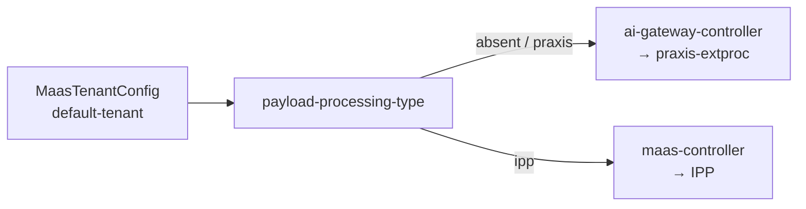
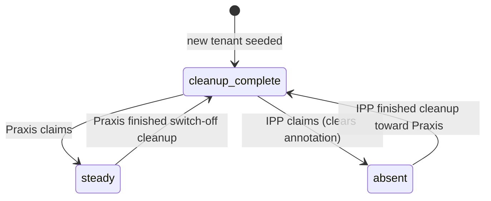

# Dataplane selection (Praxis vs IPP)

How each tenant chooses ExtProc backend, and how the two controllers hand
off shared resource names without racing. For deployment ownership, see
[Architecture](./architecture.md). For implementer detail, see
[DESIGN.md](../DESIGN.md).

## Where the selector lives

Selection is **only** on the tenant-local `MaasTenantConfig` (always named
`default-tenant` in the tenant namespace). It is **not** mirrored to
`AITenant`. Both controllers watch the same object.

| Annotation | Purpose |
| --- | --- |
| `maas.opendatahub.io/payload-processing-type` | Which backend should own ExtProc |
| `maas.opendatahub.io/payload-processing-status` | Handoff claim / cleanup progress |

## Backend type

| `payload-processing-type` | ExtProc owner | Notes |
| --- | --- | --- |
| absent / empty / unrecognized | **Praxis** (`ai-gateway-controller`) | Current product default |
| `praxis` | **Praxis** | Explicit opt-in (same as default) |
| `ipp` | **IPP** (`maas-controller`) | Explicit opt-out from Praxis |

## Handoff status

Praxis and IPP share Gateway-namespace names (`payload-processing`,
`payload-pre-processing`, and related objects). The status annotation
coordinates who may deploy.

| `payload-processing-status` | Meaning |
| --- | --- |
| `cleanup-complete` | Clear to claim — selected backend may start deploying |
| `steady` | **Praxis** owns the dataplane and may apply / resume |
| **absent** | Legacy steady when IPP is selected; **blocked** when Praxis is selected (wait for IPP cleanup) |

New tenants are seeded with `cleanup-complete` so the first deploy is not
blocked by an absent status.

### What each side does

| Situation | Praxis (`ai-gateway-controller`) | IPP (`maas-controller`) |
| --- | --- | --- |
| Selected + `cleanup-complete` | Claim → write `steady`, then deploy | Claim → clear status (absent), then deploy |
| Selected + `steady` | Resume / apply | Wait for Praxis cleanup |
| Selected + absent | Wait (IPP still cleaning up) | Treat as legacy steady |
| Switch to the other backend | Full cleanup, then write `cleanup-complete` | Mirror cleanup before the other side claims |

## When ExternalModel serving may publish

`ai-gateway-controller` publishes ExternalModel serving state only when the
**home** tenant (and each extra attachment's tenant) is on Praxis **and**
status is `steady`. An explicit `ipp` selection is a cleanup signal for
Praxis-owned model state — it does not wait for `steady`.

| Selector / status | ExternalModel publish (this controller) |
| --- | --- |
| Praxis + `steady` | Allowed (other readiness gates still apply) |
| Praxis + not yet `steady` | Hold / retain; wait for handoff |
| `ipp` | Cleanup Praxis-owned serving state |
| `MaasTenantConfig` temporarily missing | **Retain** existing serving state; do not infer backend from `AITenant` |

Serving prerequisites beyond the handoff are in
[External models](./external-models.md).

## Plugins ConfigMap migration gate

Customized `payload-processing-plugins` ConfigMaps are not silently
overwritten on IPP → Praxis upgrades. See the migration table and force
annotation in
[Praxis dataplane evolution](./praxis-dataplane-evolution.md#ipp--praxis-plugins-configmap-migration-gate-36).

## Related docs

| Doc | Audience |
| --- | --- |
| [Architecture](./architecture.md) | Who deploys whom |
| [External models](./external-models.md) | Model serving behavior |
| [DESIGN.md](../DESIGN.md) | CAS claim mechanics, finalizers, edge cases |
