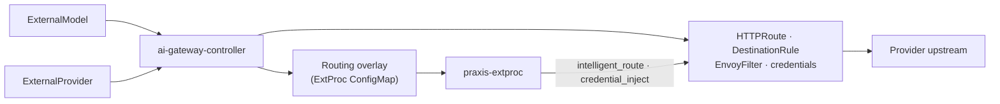

# External models

How `ExternalModel` / `ExternalProvider` become live Gateway routes and
ExtProc overlay config under Praxis. For who owns the control plane, see
[Architecture](./architecture.md). For Praxis vs IPP handoff, see
[Dataplane selection](./dataplane-selection.md). Implementer detail:
[DESIGN.md](../DESIGN.md).

## Control-plane flow

| Step | What happens |
| --- | --- |
| Resolve | Model + provider refs, weights, credentials, tenant / Gateway attachments |
| Transport | Gateway-local routes and Istio objects for the provider hop |
| Overlay | Content-addressed routing config consumed by ExtProc |
| Dataplane | Praxis ExtProc rewrites / selects; Envoy connects upstream |

Auth, API keys, and rate limits stay on the Kuadrant → maas-api path — see
[Praxis dataplane evolution](./praxis-dataplane-evolution.md).

## Serving prerequisites

All of the following must hold for this controller to publish serving state
for an attachment:

| Gate | Requirement |
| --- | --- |
| Dataplane backend | Tenant selected **Praxis** (default or explicit) |
| Handoff | `payload-processing-status` is `steady` |
| Tenant / Gateway | Owning `AITenant` has a usable Gateway ref and is deploy-ready (not Failed) |
| Gateway object | Referenced Gateway exists |
| Model placement | Home path: `MaasTenantConfig` in the model namespace (or an explicit `gatewayRefs` binding) |

If `MaasTenantConfig` is temporarily missing, existing serving state is
**retained** — the controller does not guess a backend from `AITenant` alone.

## Gateway attachments (`spec.gatewayRefs`)

Optional list of Gateway namespace/name pairs (1–16 unique entries when set).

| `gatewayRefs` | Behavior |
| --- | --- |
| **Omitted** | Home attachment only — tenant whose `MaasTenantConfig` is in the model namespace |
| **Names home Gateway** | Same as home path |
| **Names another tenant's Gateway** | Extra attachment — resolved Gateway → owning `AITenant` → that tenant's `MaasTenantConfig` |
| **Namespace with no `MaasTenantConfig` and no refs** | No serving state (`Pending` / `TenantNotResolved`) |

Explicit bindings never fall back to a different Gateway.

### Attachment readiness (high level)

| Outcome | Typical meaning |
| --- | --- |
| Ready | Attachment reconciled and distributed for that Gateway |
| `TenantNotPraxis` / `TenantNotSteady` | Target tenant not on Praxis + `steady` (existing state may be retained) |
| `GatewayNotManaged` / `AmbiguousTenant` | Gateway → tenant resolution failed |
| `AttachmentPending` | Cross-tenant serving not yet fully enabled — no serving state for that attachment |

Aggregate model Ready requires every requested attachment to succeed. Status
reports the first failing attachment in `gatewayRefs` order until per-Gateway
status lands.

## Providers and credentials

| Topic | Behavior |
| --- | --- |
| Provider namespace | Omitted namespace on a provider ref means the **model** namespace |
| Inherited auth | Provider-local Secret |
| Override auth | Model-local Secret |
| Secret refs | Name-only |
| Cross-namespace provider | Skipped until authorization is implemented — no silent substitute |

### Provider weights (same client-visible model)

| Weights | Result |
| --- | --- |
| Single eligible provider | Deterministic |
| Equal positive weights | Uniform `random` selection in Praxis |
| Omitted weight | Treated as `1` |
| Weight `0` | Provider disabled for that model |
| Unequal positive weights | Rejected (`WeightUnsupported`) |
| Same provider repeated across models with the same client-visible name | Rejected (would bias random selection) |

Proportional weighting, health-aware selection, and retries are out of scope
for the current behavior.

## Cleanup notes (operators)

- Switching a tenant to `ipp` cleans up Praxis-owned model serving state for
  that tenant.
- On Gateway move, the controller applies the new copy first and removes only
  the old copy for the same tenant identity — neighboring tenants are left
  alone.
- Deletion with sibling models and no resolvable tenant handoff is
  **conservative**: shared Praxis state is not rebuilt blindly; finalizers may
  remain until handoff objects return or siblings are gone.

## Related docs

| Doc | Audience |
| --- | --- |
| [Architecture](./architecture.md) | Component ownership |
| [Dataplane selection](./dataplane-selection.md) | Praxis / IPP annotations |
| [Praxis dataplane evolution](./praxis-dataplane-evolution.md) | Request path |
| [DESIGN.md](../DESIGN.md) | Schema extension, finalizers, migration edge cases |
